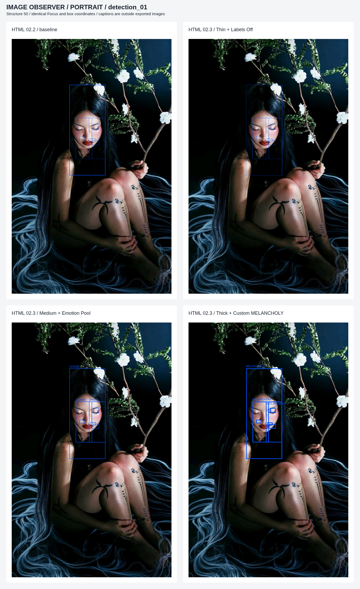
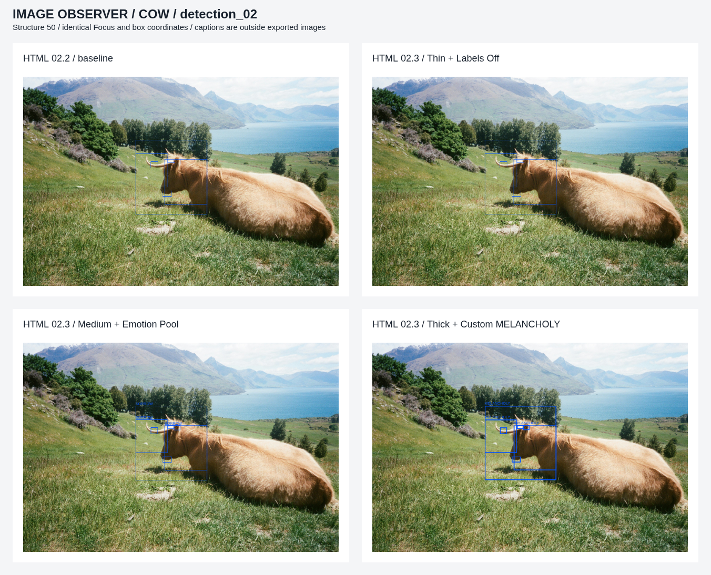

# IMAGE OBSERVER · HTML BUILD 02.3 验收

正式路线已切换为 **HTML + CSS + JavaScript / Canvas**。本轮只补齐线宽和情绪标签，没有改 Detection 算法，没有新滤镜，没有部署 GitHub Pages 或 Render。等待用户验收后再部署固定网址。

## 下载和打开

- [下载完整可运行 HTML 源码包](Image-Observer-HTML-Build-02.3.zip)：解压后用 Chrome / Edge 打开 **Image-Observer-Build-02.3.html**。
- [单独查看 / 下载最新版 HTML](../image-observer-v1.html)：GitHub 文件页选择 **Download raw file**，保存为 HTML 再打开。GitHub 源码预览页本身不是在线工具。
- [下载本轮全部测试图片 ZIP](Image-Observer-HTML-Build-02.3-Test-Results.zip)。

正式运行包只有本轮 HTML、说明和版本清单；HTML 包含完整可读 CSS 与 JS，没有后台、安装依赖、旧 HTML、Python 或 BAT。

## 人像对比

以下四宫格依次为：左上 HTML 02.2 基线、右上 02.3 Thin + Off、左下 02.3 Medium + Emotion Pool、右下 02.3 Thick + Custom MELANCHOLY。说明文字在对照图边缘，不属于实际导出图片。

[查看完整尺寸人像对照图](detection_01_html_build_02_3_comparison.png)

## 牛图对比

[查看完整尺寸牛图对照图](detection_02_html_build_02_3_comparison.png)

## 实际导出的完整 PNG

两张图均为 Structure=50、检测 Seed=0；同一张图的 A / B / C / D 使用同一个 Focus 和完全相同的框数据。

| 输入 | 原始尺寸 | 输出尺寸 | 实际点击 Focus |
| --- | --- | --- | --- |
| detection_01 / 人像 | 909×1447 | 909×1447 | (430,518) |
| detection_02 / 牛 | 1930×1280 | 1600×1061 | (750,510) |

| 输入 | A：Thin / Off | B：Medium / Pool | C：Thick / Custom |
| --- | --- | --- | --- |
| 人像 | [PNG](detection_01_portrait_html_build_02_3_s050_focus_x0430_y0518_A_thin_off.png) | [SHAME](detection_01_portrait_html_build_02_3_s050_focus_x0430_y0518_B_medium_emotion_pool.png) | [MELANCHOLY](detection_01_portrait_html_build_02_3_s050_focus_x0430_y0518_C_thick_custom_melancholy.png) |
| 牛 | [PNG](detection_02_cow_html_build_02_3_s050_focus_x0750_y0510_A_thin_off.png) | [SORROW](detection_02_cow_html_build_02_3_s050_focus_x0750_y0510_B_medium_emotion_pool.png) | [MELANCHOLY](detection_02_cow_html_build_02_3_s050_focus_x0750_y0510_C_thick_custom_melancholy.png) |

| 输入 | 初始词 | Shuffle 1 | Shuffle 2 | Shuffle 3 |
| --- | --- | --- | --- | --- |
| 人像 | SHAME | [CALM](detection_01_portrait_html_build_02_3_s050_focus_x0430_y0518_D_medium_pool_shuffle_1.png) | [MELANCHOLY](detection_01_portrait_html_build_02_3_s050_focus_x0430_y0518_D_medium_pool_shuffle_2.png) | [DREAD](detection_01_portrait_html_build_02_3_s050_focus_x0430_y0518_D_medium_pool_shuffle_3.png) |
| 牛 | SORROW | [AFFECTION](detection_02_cow_html_build_02_3_s050_focus_x0750_y0510_D_medium_pool_shuffle_1.png) | [GRATITUDE](detection_02_cow_html_build_02_3_s050_focus_x0750_y0510_D_medium_pool_shuffle_2.png) | [SORROW](detection_02_cow_html_build_02_3_s050_focus_x0750_y0510_D_medium_pool_shuffle_3.png) |

每次新词都不同于紧邻的前一个词；之后可以再次抽到更早的词。每张画面只使用一个词，词语为独立随机视觉标签，不是情绪识别结果。主 / 中框同词，微框无字。

## 技术与功能验收

- **原算法不变**：Detection 首段脚本与 HTML 02.2 逐字节一致；两图 × 自动 / 两处 Focus × Structure 0 / 50 / 100 共 **18 组**框坐标逐项一致。
- **显示变化不重新检测**：对检测入口实际计数并临时设为抛错后测试显示控件，线宽、标签、自定义文本和 Shuffle 新增检测调用均为 **0**，框坐标 / 大小 / 数量完全不变。
- **线宽**：1 / 2 / 4px 在所有层级向内绘制，实际像素覆盖与期望区域一致，框外底图不被描边改变。
- **标签**：准确 30 个既定词，无 DESIRE；标签只来自主框、中框，单画面同词；字体在本地测量，边界有效，次要中框按碰撞情况避让或隐藏。
- **文字输入**：小写自动大写、32 字符上限、逐字输入含空格短语、空文本及切回 Pool 恢复此前单词均通过。
- **可重复性**：独立固定随机序列逐步重放一致；每次 Shuffle 改词；重新选择同一图片初始化同一词，检测 Seed 不受词语状态影响。
- **Focus 与状态**：真实鼠标坐标映射通过；Structure 保留 Focus 和当前词，Reset 恢复自动，新图清旧 Focus；两个独立浏览器上下文互不污染图片、Focus、框和词。
- **PNG**：12 张 02.3 PNG 均实际点击下载按钮保存，与当时 Canvas PNG 字节一致。显示参数改变不影响已经点击的导出快照，新图会取消旧图片的延迟导出。
- **尺寸与异常**：横图、竖图、方图、不放大、最长边 1600、1×1 fallback、伪装格式与损坏文件均通过；前端异常和外部网络请求为空。
- **源码包**：解压后唯一 HTML 与验收源码 SHA-256 一致，清单 / 版本标题 / ZIP CRC 已核对，不包含旧 02.2 入口。

### 离线验证的实际边界

已在 Chromium 的**断网文档环境**加载同一份完整 HTML，验证图片上传、标签和实际 PNG 下载，无网络请求；正常静态 HTTP 方式也完成上述验收。全部资源内联，没有任何服务端处理。

本执行环境的管理员策略阻止 `file://` 自动导航，因此没有绕过策略，也**没有声称 Windows 上双击本地文件已实机验证**。下载后在用户电脑实际打开是待用户确认的一项；不同浏览器 / 系统字体和图片解码可能有像素差异。未测试 Safari / Firefox，不保证超大原图在所有设备上都流畅。

## 源码、归档与停止点

- 正式源文件：`image-observer-v1.html`。第一段原 Detection / 后处理保留；第二段 `ObserverOverlay` 管理文字、独立词语状态和绘制；第三段接收页面事件、缓存框及导出。
- `README.md` 改为 HTML 运行与验收说明；`archive/` 保存原 HTML 02.2 与 Python 稳定版。未审核的 Render 草稿只在本地归档，不随本轮 GitHub 或运行包交付。
- 没有改写 Python / Gradio 功能，也没有继续维护 Python 或部署 Render。
- 本轮只通过现有 GitHub 仓库交付源代码和测试图，**不启用 GitHub Pages，不提供伪造的已上线网址，不进入 02.4**。

[当前源码与回归机器记录](html_build_02_3_validation.json) · [运行包清单](html_build_02_3_manifest.json) · [实际页面截图](html_build_02_3_page.png)
